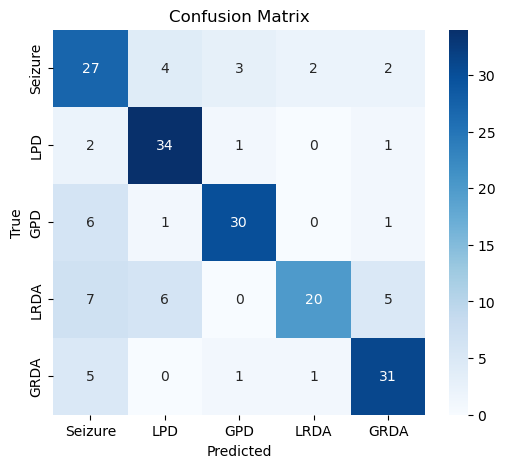
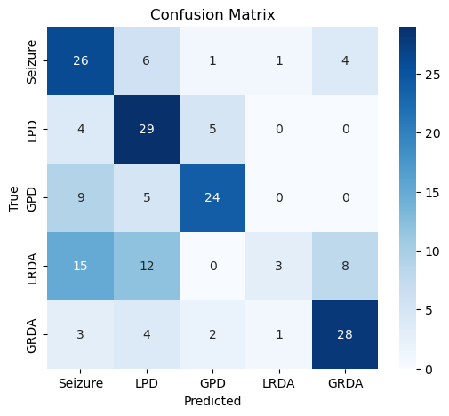
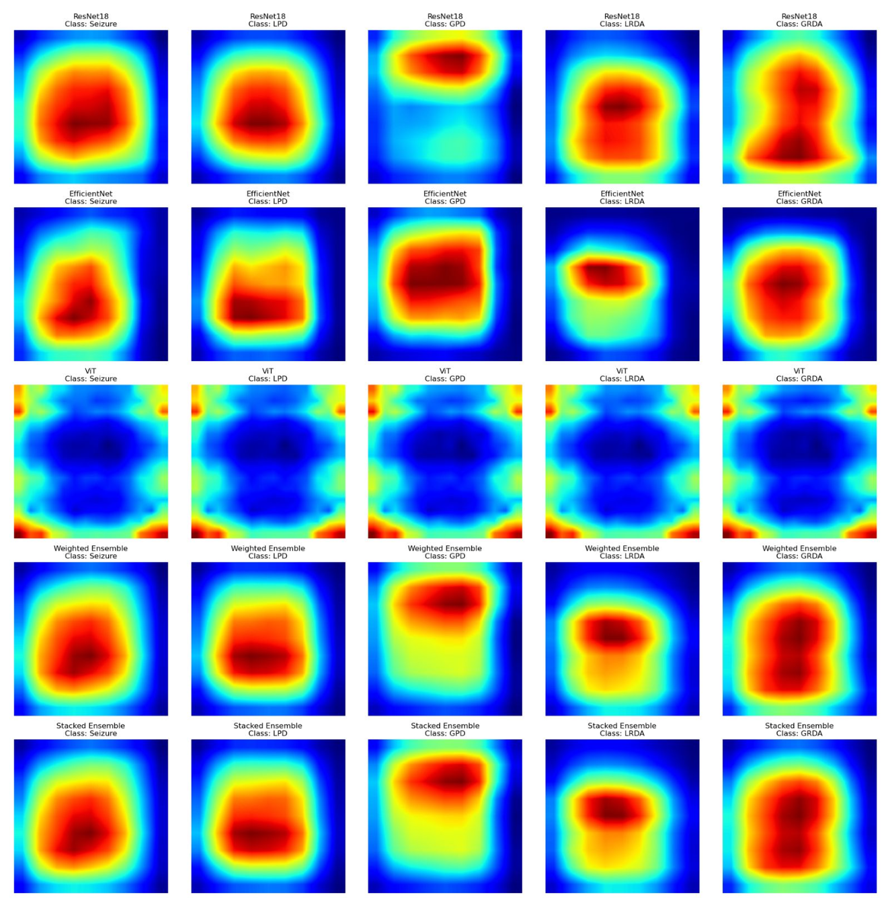

# harmful-brain-activity-classification
**Interpretable EEG-based Harmful Brain Activity Classification using Deep Learning**

University team project (Team GM2, 5 members) · Supervisor: Dr. Georgios Moulantzikos

## Overview
EEG is central to diagnosing neurological conditions such as seizures and brain injury, but reading it is slow, costly and subjective: agreement between expert clinicians is often low, and visually similar abnormal patterns are easy to confuse. This project builds deep-learning models that classify five harmful EEG patterns (**Seizure, LPD, GPD, LRDA, GRDA**) and uses explainability methods to show *why* each prediction was made, so the output can serve as a second opinion a clinician can check rather than take on faith.

## Research Questions
1. **Classification**: Can CNN-based models trained on EEG scalograms reliably distinguish five harmful brain activity patterns?
2. **Model choice**: How do different architectures (2D CNN, ResNet18, EfficientNet, ViT) and their ensemble compare?
3. **Interpretability**: Do the models attend to clinically meaningful signals rather than background noise?

## Key Findings
- **Depth matters.** ResNet18 reached **~75% accuracy**, about **30 percentage points** above a plain 2D CNN baseline, which was discontinued due to poor generalisation.
- **Ensembling helps on hard classes.** Some LRDA samples were misclassified as Seizure or LPD by single models; a weighted ensemble mitigated this and lifted overall accuracy to **~81%**.
- **The model looks at the right signals.** Grad-CAM showed ResNet18 attends to clinically meaningful EEG activity rather than background noise, supporting the transparency needed for AI-assisted diagnosis.
- **Explainability does not transfer to every architecture.** Grad-CAM produced uninterpretable heatmaps for ViT, so attention-based methods are needed for transformer models.

## Dataset
- Source: [Kaggle, HMS - Harmful Brain Activity Classification](https://www.kaggle.com/competitions/hms-harmful-brain-activity-classification)
- 50-second EEG segments, each labelled as one of five harmful activity classes (the "Other" class was excluded)

## Method

### Preprocessing
- Montage transformation of raw EEG signals
- Bandpass filtering (0.5–40 Hz)
- Continuous Wavelet Transform (CWT) to convert signals into scalogram images
- Resized to 224 × 224 for CNN input

### Models
| Model | Role | Owner |
|-------|------|-------|
| **2D CNN** | Baseline (discontinued) | Me |
| **ResNet18** | Deeper CNN with residual connections | Me |
| EfficientNet | Efficient CNN scaling | Team |
| Vision Transformer (ViT) | Attention-based model | Team |
| Weighted ensemble | ResNet18 + EfficientNet + ViT | Team |

## Results Summary
| Model | Accuracy |
|-------|----------|
| ResNet18 | ~75% |
| Weighted ensemble | ~81% |

**ResNet18 confusion matrix**
<p align="center">
  
</p>

**2D CNN baseline confusion matrix**
<p align="center">
  
</p>

## Interpretability Analysis
Grad-CAM was applied to ResNet18 to visualise which regions of the scalogram drove each prediction.

<p align="center">
  
</p>

- Strong sensitivity on **LPD** and **GRDA**, where the model captured distinct patterns within the scalograms
- Heatmaps concentrated on clinically meaningful EEG activity rather than background noise
- **Limitation**: Grad-CAM does not support ViT well; future work could use SHAP, Attention Rollout or LRP for transformer explainability

## My Role
- Implemented and trained the **2D CNN** baseline and **ResNet18**
- Proposed and applied **Grad-CAM** for model interpretability
- Collaborated on model evaluation and ablation studies

## Repository Structure
```text
├── models/
│   ├── 2DCNN.ipynb        # 2D CNN baseline
│   ├── ResNet18.ipynb     # ResNet18 training, evaluation and Grad-CAM
│   └── README.md          # Model notes
└── assets/                # Confusion matrices and Grad-CAM figures
```

## Tech Stack
Python, PyTorch, scikit-learn, Matplotlib, Seaborn
